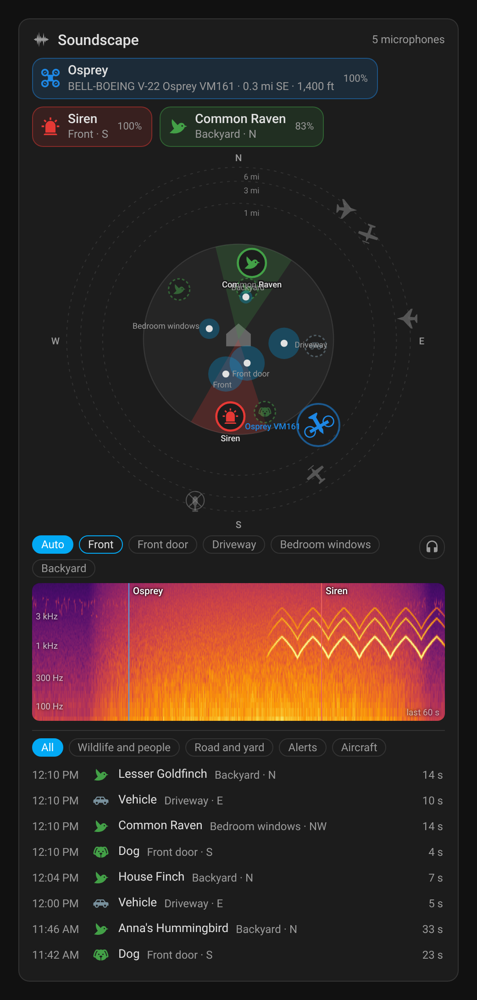
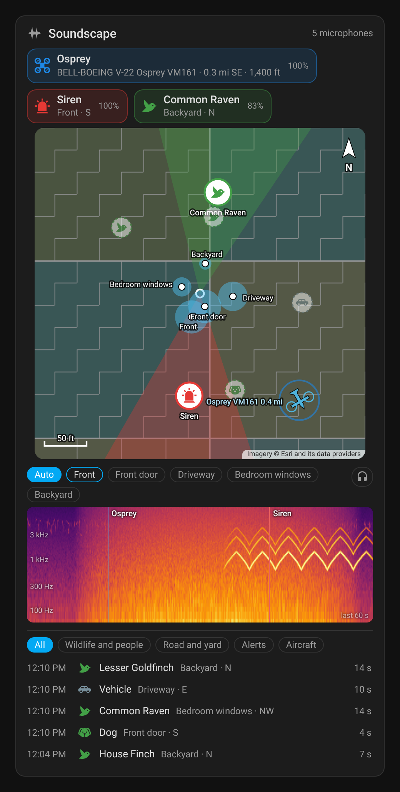

# Soundscape

A Home Assistant integration and dashboard card that listen to the microphones in your cameras, say what is making each sound, and show where it is coming from.



It hears and locates birds (by species), coyotes, dogs, passing vehicles, sirens, car alarms, breaking glass, bangs, and aircraft, which it separates into jets, propeller aircraft, helicopters and the V-22 Osprey. The card shows what is being heard now, a radar of the property and the sky around it (schematic, or over a street or satellite map), a live spectrogram in the manner of BirdNET-Go's, a button to listen live, and a scrolling log.

## How it decides

No single source can name all of these, so Soundscape combines five and shows its reasoning for every sound (tap a chip or a log row).

| Source | What it contributes |
| --- | --- |
| Its own analysis of each camera's audio | The spectrogram; sirens (a tone sweeping or stepping between about 400 and 1800 Hz); howls; helicopter and tiltrotor blade beat (9 to 32 Hz); propeller harmonics (55 to 150 Hz fundamental); how far each microphone sits above its own background |
| Frigate audio detection | Any of Frigate's sound labels you have told it to listen for: barks, glass, car alarms, gunshots, speech, and the rest |
| Frigate object detection | A car, truck or motorcycle moving on a camera; a dog seen at night |
| [BirdNET-Go](https://github.com/tphakala/birdnet-go) | Bird species per microphone, including what it is hearing right now, and its coyote, dog, siren and engine classes |
| ADS-B | Aircraft near the house with type, altitude and track. Types are classed as jet, propeller, helicopter or tiltrotor from the ICAO type designator |
| A public dispatch list (optional, twelve agencies built in) | After a siren, the dispatches of the same few minutes near the house |

**Where.** Camera audio streams are not synchronized closely enough to time a sound's arrival at each microphone, so direction comes from loudness: each microphone's rise above its own background, weighted by where you said that microphone is. That gives a side of the house and a compass direction, not a point on a map. A sound equally loud everywhere is reported as overhead or distant. For an aircraft matched on ADS-B the position is the aircraft's own, moved back along its track by the time its sound took to arrive.

**Aircraft.** A rotor beat or propeller harmonics heard on most microphones is matched to the likeliest audible aircraft on ADS-B, which then supplies the type: "Osprey", "Sikorsky UH-60", "Cessna 172". A plain roar counts as a jet only when ADS-B shows one close enough, because wind and rain roar too. Aircraft are never reported from ADS-B alone; something has to be heard.

**Osprey without a transponder.** Military aircraft often do not appear on ADS-B. The V-22's three-bladed rotors beat at about 19.9 Hz in the hover and 16.7 Hz in cruise, and a rotor heard in either band with no transponder is labelled "Helicopter or Osprey" with the measured rate. It is not called an Osprey outright because a UH-60's 17.2 Hz falls inside the cruise band.

## What to expect

The audio analysis has been tested on synthesized sirens, howls, rotors and propellers, and the whole chain has been run inside a Home Assistant core against sound files. It has not yet been tuned on recordings from real cameras, and several things will need that:

- Coyotes and sirens overlap in pitch. A howl is reported only with support from Frigate's `howl` label, BirdNET-Go's coyote class, or a dog seen on camera at night.
- A vehicle is reported when a pass-by is heard and Frigate also sees or hears one. Sound alone is not enough.
- Thresholds are in `dsp.py` and `fusion.py` and are deliberately plain numbers.
- Cameras that encode audio as G.711 carry nothing above 4 kHz. AAC at 16 kHz or more is better for everything here, and for BirdNET-Go.

## Install

1. In HACS, add this repository as a custom repository of type **Integration**, install Soundscape, and restart Home Assistant. (Or copy `custom_components/soundscape` into `/config/custom_components`.)
2. **Settings → Devices & services → Add integration → Soundscape.**
   - *Frigate address* is filled in from the Frigate integration. Internally the add-on is usually `http://ccab4aaf-frigate-fa:5000`.
   - *BirdNET-Go address*: for the add-on, `http://db21ed7f-birdnet-go:8080`.
   - *Aircraft positions*: adsb.fi, adsb.lol and airplanes.live need no account. If you run your own receiver, choose it and give its `aircraft.json` address.
   - *Emergency dispatch list*: left on "Nearest", it uses the built-in agency closest to the house if one is within 80 km. See the list below.
   - *Distances*: automatic follows Home Assistant's unit system, miles and feet for US customary and kilometres and metres otherwise. Either can be forced.
   - Pick the cameras to listen to, then give each microphone's compass bearing and distance from the middle of the house.
3. Add the card. The integration loads it; there is no resource to register.

```yaml
type: custom:soundscape-card
title: Soundscape
show_radar: true
radar: schematic
map_style: streets
map_radius_m: 60
range_km: 10
radar_recent_seconds: 120
units: auto
show_spectrogram: true
mic: auto
spectrogram_height: 150
spectrogram_seconds: 60
show_listen: true
volume: 80
show_log: true
log_rows: 8
log_max: 100
log_hide: []
```

Everything is also in the card's visual editor.

| Option | Default | |
| --- | --- | --- |
| `radar` | `schematic` | `schematic` draws distance logarithmically, so the yard and aircraft miles out share one view. `map` puts a real map behind it at true scale. |
| `map_style` | `streets` | `streets` (OpenStreetMap) or `satellite` (Esri World Imagery). For another source set `map_tiles` to a `{z}/{x}/{y}` address and `map_attribution` to its credit line. |
| `map_radius_m` | `60` | How far the map reaches from the house. About 60 shows the property; a few thousand shows the neighbourhood and nearby aircraft. Aircraft beyond the edge sit on it with their distance. |
| `range_km` | `10` | Outer ring of the schematic radar. |
| `radar_recent_seconds` | `120` | Sounds that have ended stay on the radar, faded, for this long. `0` turns that off. |
| `units` | `auto` | `auto` follows the integration; `km` or `mi` overrides it for this card. |
| `mic` | `auto` | Which microphone the spectrogram shows: the one hearing the most, or a camera name. |
| `show_listen`, `volume` | `true`, `80` | The headphones button plays the shown microphone live, with mute and a volume slider. |
| `log_rows` | `8` | Rows visible before the list scrolls. |
| `log_max` | `100` | Rows kept in the list (the integration holds the last 150 sounds). |
| `log_hide` | `[]` | Kinds to leave out of the list, for example `[vehicle, voice]`. |



On the radar each aircraft is drawn by kind (jet, propeller, helicopter, Osprey) pointing along its track, and each sound on the ground carries its own icon and name. The filter chips above the list narrow it to wildlife and people, road and yard, alerts, or aircraft.

Two things to know about privacy. In map mode the browser fetches map tiles for the house's location from the map provider, as any map does. Live listening sends that camera's audio to the browser of whoever pressed the button, and only while it is pressed; any Home Assistant user who can see the card can do so.

### Dispatch lists

| Agency | Location given as |
| --- | --- |
| San Diego Fire-Rescue | street and cross street |
| Seattle Fire | coordinates |
| San Francisco law enforcement (about 10 to 20 minutes behind) | intersection |
| Ventura County Fire | coordinates |
| Phoenix Fire (regional) | coordinates |
| Austin and Travis County Fire | coordinates |
| Dallas Police | block and street |
| Houston Fire and Police | street and cross street |
| Tulsa Fire | coordinates |
| Nashville Fire | ZIP code only |
| Orlando Police | block and street |
| Richmond, Virginia Police and Fire | block and street |

Each was publishing live when it was added, in November 2026. Where a feed gives a street instead of coordinates, the street is looked up once inside a box around the house, so the distance shown is approximate and says so. Los Angeles city and county publish no open real-time list; theirs is on PulsePoint, which has no public interface. Several other large cities (New York, Chicago, Boston, Washington) publish nothing in real time, and a few that do were left out because the feed was stale or forbids automated reading. Adding an agency is one entry and one small parser in `dispatch.py`.


Audio is read from Frigate's go2rtc restream (`rtsp://<frigate>:8554/<camera>`), one audio-only ffmpeg process per camera. If a camera's restream has another name, or a microphone is not a Frigate camera, add a line `name=address` under *Other microphones*.

### Tell Frigate what to listen for

Frigate only reports the sound labels in its `listen` list, and by default that list is short. Soundscape picks up each `binary_sensor.<camera>_<label>_sound` as it appears.

```yaml
audio:
  enabled: true
  listen:
    - bark
    - howl
    - yip
    - speech
    - yell
    - scream
    - fire_alarm
    - smoke_detector
    - siren
    - emergency_vehicle
    - car_alarm
    - glass
    - shatter
    - gunshot
    - explosion
    - fireworks
    - vehicle
    - motorcycle
    - honk
    - aircraft
    - helicopter
    - propeller
    - jet_engine
```

## For automations

- `sensor.soundscape_now_hearing`, with every current sound in its attributes.
- A binary sensor each for siren, coyote, dog, bird, vehicle, car alarm, breaking glass, bang, alarm, aircraft (any kind), helicopter and Osprey, with where and why in the attributes.
- A `soundscape_event` on the event bus when a sound starts and when it ends.

## Development

```
python -m pytest tests                     # analysis and fusion, numpy only
pip install pytest-homeassistant-custom-component ha-ffmpeg home-assistant-frontend
python -m pytest tests                     # adds the run inside Home Assistant
python dev/make_fixture.py && python dev/shot.py   # render the card from synthetic audio
```

## Credits

The spectrogram follows the look of [BirdNET-Go](https://github.com/tphakala/birdnet-go) by Tomi P. Hakala, which also supplies the bird identifications. Sound and object labels come from [Frigate](https://frigate.video). Maps are OpenStreetMap or Esri World Imagery. Aircraft positions come from the community ADS-B networks, and type data from [tar1090-db](https://github.com/wiedehopf/tar1090-db). Street lookups use OpenStreetMap's Nominatim. MIT licensed.
